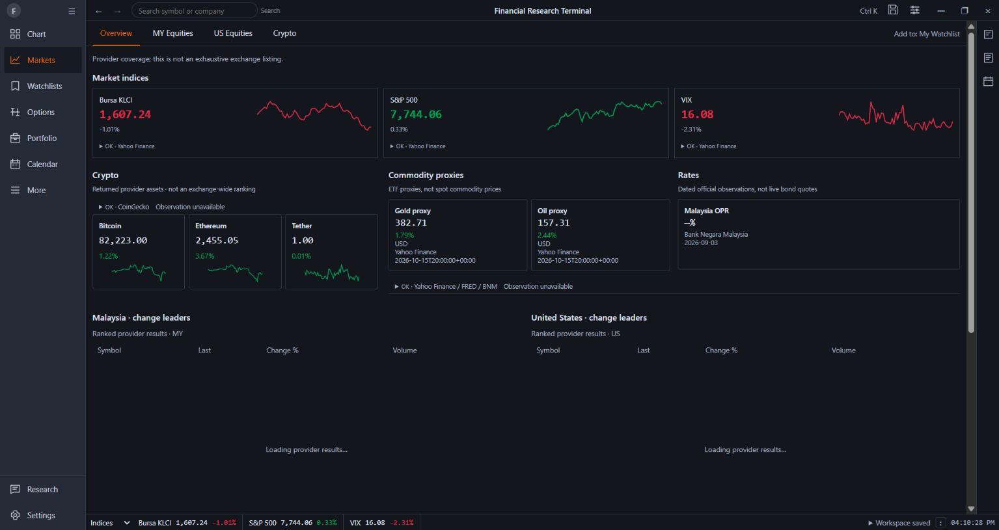
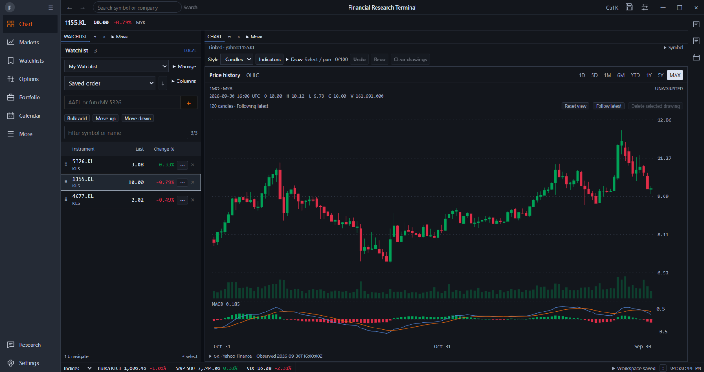

# Financial Research Terminal




Tauri + React interface with a native Rust market engine. The desktop opens a
moomoo-inspired dark workspace with an integrated title/search bar, collapsible
horizontal-label navigation, interactive OHLC charts,
named watchlists with configurable quote columns and bulk entry, linked/pinned
panels, two/four-chart presets, and a responsive instrument inspector. Markets
browses existing MY/US equity and crypto providers with explicit local-watchlist
add actions. An index ticker, right-side information tools, aligned options chain,
weekly calendar and contextual controls follow the inspected desktop design.
See the [reference comparison checklist](docs/desktop-design-checklist.md). It defaults
to live provider data through the existing FastAPI market services. Synthetic
data is available only through explicit mock mode.
Portfolio services use backend SQLite and work with the lightweight gateway.
Research remains on the full PostgreSQL backend. Existing PostgreSQL portfolio
records are retained for explicit migration. The previous web interface is
archived under `frontend/legacy`.

## Run locally

Start the live gateway with `uv run --frozen python -m uvicorn app.bootstrap.market_application:app --host 127.0.0.1 --port 8000 --http h11`.
Then run `npm --prefix frontend ci`, followed by `npm --prefix frontend run desktop:dev`.
The Ratatui CLI is removed. See the [native terminal guide](docs/rust-terminal.md)
for HTTP mode, packaging, commands, and local storage. The backend and historical
web-interface documentation below remain reference material for existing services.

For backend services, Python 3.12+, uv, Node 24 (matching CI), Rust 1.99 and PostgreSQL are required.
Copy `.env.example` to `.env` and configure DB_URL and the model/provider settings.

```powershell
uv sync --frozen
uv run --frozen python scripts/setup_analytics.py
rustup toolchain install 1.99.0 --profile minimal --component rustfmt --component clippy
cargo +1.99.0 build --locked
npm --prefix frontend ci
npm --prefix frontend run build
uv run --frozen python -m uvicorn app:app --host 127.0.0.1 --port 8000 --http h11
```

The explicit `--http h11` uses Uvicorn's supported Python HTTP parser and avoids
automatic selection of an incomplete optional `httptools` installation.

The backend remains at [localhost:8000](http://127.0.0.1:8000). Launch the desktop
with `npm --prefix frontend run desktop:dev`; a plain browser displays a native-runtime
requirement. The backend still serves static assets and returns 404 for unknown API routes.

On Windows, native compilation needs Visual Studio C++ Build Tools. An existing Linux
ELF build in `target/debug/financial-engine` can run through installed WSL; the adapter
detects it when a Windows executable is absent. Override ENGINE_COMMAND with a trusted
JSON argument array if needed, for example:
`["wsl.exe","-d","Ubuntu-22.04","--","/mnt/d/Learning/Project/analysis_deepagent/target/debug/financial-engine"]`.
Build inside WSL with the pinned toolchain, or supply a Windows executable. Python
uses a small PostgreSQL thread bridge on Windows Proactor loops; Linux uses the native
async driver. The graph and MCP execution remain asynchronous and cancellable.

## Architecture

- Tauri + React owns the active market interface; typed IPC connects it to the Rust
  terminal engine. The previous web workflows are archived under `frontend/legacy`.
- Python owns exact-symbol provider retrieval, normalization, transactional persistence
  and `create_deep_agent` configuration. No silent exchange suffix guessing or FX conversion.
- Rust owns decimal ledger accounting, valuation, performance and quantitative tools.
  Financial results are decimal strings; charts use finite numeric values.
- The LangChain `MCPAdapter` is pinned through `langchain[mcp]`. Connections are bounded
  and organization-scoped. Missing Rust infrastructure fails explicitly; there is no
  Python calculation fallback.
- Deep Agents uses native planning/delegation and isolated specialists. `/scripts/` is
  a shared read-only folder with curated, bounded script execution. Skills are explicitly
  supplied to specialists. Existing script limits and hash checks remain in force.
- Checkpoints use org/user-prefixed thread IDs. Memory uses `(memories,org,user)`.
  Authentication and organization boundaries apply to research, portfolios and native tools.

### Module layout

| Location | Responsibility |
| --- | --- |
| `app/bootstrap` | ASGI composition, resource lifecycle and SPA serving |
| `app/research`, `app/market`, `app/portfolio`, `app/backtesting` | Feature routes, services and contracts |
| `app/infrastructure` | Authentication, configuration, providers, PostgreSQL, traces and native transport |
| `orchestrator` | Deep Agent configuration, specialists, policy, budgets and capability-specific tools |
| `contracts` | Shared context, evidence and namespace contracts without HTTP dependencies |
| `financial_analytics` | Reviewed schemas/catalog and isolated Python-only calculations |
| `crates` | Rust data pipeline, quantitative engine and MCP server |
| `frontend/src/features`, `frontend/src/shared` | Feature pages/components and shared client utilities |
| `tests/unit`, `tests/integration`, `tests/support` | Feature-grouped tests and common fixtures |
| `evaluation/baselines` | Independent Rust comparison formulas and offline benchmark workers |

Keep HTTP wiring in the bootstrap and route modules. Production packages must not
import evaluation code or sample libraries; agent modules must not import HTTP routes.
See [the maintenance guide](docs/maintainability.md) for dependency rules and checks.

### Fresh-install compatibility

This version targets fresh installations. It does not import old LangGraph portfolio
records, recover undated legacy holdings, migrate retired checkpoint channels, or accept
`analysis_report` as a response selector. Use a new empty database configured through
`DB_URL`; startup creates current tables. Existing databases are not reset or deleted,
but old-format data is unsupported. Back up an older installation before upgrading.

## Portfolio contract

Create an empty portfolio; add BUY/SELL/DIVIDEND transactions. Holdings derive from a
weighted-average ledger. Sell quantities cannot exceed holdings; dividends use quantity
and amount per share. Repeating a transaction ID is idempotent; conflicting details fail.
The UI refreshes quotes every five minutes while visible and supports manual refresh.

Portfolio documents use local backend SQLite with transactional writes and revisions.
The lightweight market backend supports portfolios without PostgreSQL; research
still uses PostgreSQL. See [SQLite portfolio storage](docs/portfolio-sqlite.md)
for file locations and the non-destructive migration command for existing records.
Holdings and exports derive from recorded transactions and current portfolio documents.

JSON imports use the Financial export contract: `format_version`, `portfolio_name`, `owner`,
`currency`, `export_date`, `transactions` with date/symbol/type/quantity/price/notes.
Exports preserve transaction IDs and add the benchmark. Import modes are **New** and
**Merge**, with preview/hash/revision validation followed by an atomic commit. Holdings-only
imports are rejected. Same-day transaction order is retained.

Recorded performance uses saved valuations, common benchmark dates and an end-of-period
trade-flow adjustment. Sparse snapshots limit accuracy. Fixed-holdings adjusted-price
projections are labelled separately. Neither includes cash, fees, taxes or FX; mixed
currency comparisons fail rather than returning misleading totals.

Portfolio APIs are under `/api/portfolio`: list, create, load/update/delete, symbols,
transactions, summary, export, import/preview and import/commit. `revision` protects
concurrent edits. Production access requires configured OIDC identity and a verified
bearer access token;
organization/user scope comes from token claims rather than request fields. Configure
`APP_ENV=production`, `OIDC_ISSUER`, `OIDC_JWKS_URL`, `OIDC_AUDIENCE`, `OIDC_CLIENT_ID`
and the organization claim through `.env.example`. OIDC endpoints must use HTTPS.
Set `PORTFOLIO_ENABLED=true` to enable portfolio routes.

## Research contract

`response_schema` defaults to `financial`, the only supported response selector.
`/api/chat` returns `{success,result,todos,files,thread_id,error}`. `result` is readable
Markdown. SSE `/api/chat/stream` emits progress, tool activity, financial_statements and
one final `done` envelope. A missing final answer or truncated stream is not success.
Internal evidence receipts stay in message artifacts; provider/native receipt integrity,
role restrictions and token/tool limits remain enforced. No AnalysisReport model or
schema completion tool is used. Current text and evidence envelopes render as readable text.

DCF uses explicit registered forecast assumptions and validated historical snapshots.
Risk/ratio tools fetch exact-symbol normalized snapshots or reuse supplied snapshot IDs.
Curated commands and limits are documented in [scripts/AGENTS.md](scripts/AGENTS.md)
and [curated-providers.md](scripts/data_sources/curated-providers.md).
[manifest.json](scripts/data_sources/manifest.json) records provider hashes and upstream
attribution, including the upstream license link. Provider scripts use LF line endings
through `.gitattributes` so hash verification agrees across Windows and Linux. When
changing a provider, update its manifest SHA-256 to match the resulting file bytes.
Standalone financialanalysis/report-generator CLIs remain available;
they are not a second live calculation path for the web application.

## Windows desktop

The Tauri shell connects to a managed backend. Configure `frontend/.env.production`
with `VITE_BACKEND_URL` pointing to the trusted HTTPS backend and
`VITE_OIDC_REDIRECT_URI` matching the callback registered with your identity provider.
Configure `OIDC_CLIENT_ORIGINS` on the backend for the permitted frontend origins.

```powershell
npm --prefix frontend run desktop:dev
npm --prefix frontend run desktop:check
npm --prefix frontend run desktop:build
```

Desktop compilation requires the Windows C++ build tools. The desktop build produces
an NSIS installer; the backend runs separately, with PostgreSQL required for research.

## Verification

```powershell
cargo +1.99.0 test --locked
cargo +1.99.0 fmt --all --check
cargo +1.99.0 clippy --locked --workspace --all-targets -- -D warnings
uv run --frozen python -B -m unittest discover -s tests -t . -v
npm --prefix frontend run build
cd frontend
npx playwright install chromium
npm test
# Requires TEST_DB_URL and ENGINE_COMMAND for the production-build fixture.
npm run test:production
```

Set ENGINE_TEST_COMMAND to a JSON executable argument array for Rust integration tests,
and TEST_DB_URL for isolated PostgreSQL tests.
On Windows, executable paths end in `.exe`; on Linux, they do not. Set
`PYTHON_DOTENV_DISABLED=1` for isolated test runs.
Tests requiring unconfigured integration services are skipped.
`PLAYWRIGHT_CHANNEL=chrome` uses installed Chrome locally.
CI runs Rust checks on Linux and Windows, database integration on Linux, and React browser
tests against both mocked APIs and the production build. The production fixture uses
real PostgreSQL/Rust with deterministic model/provider responses. CI also checks
Python dependency consistency and runs Tauri tests, formatting and strict Clippy
on Windows. These checks do not verify live model or financial-provider availability.

## Built-in traces

Open **Traces** in the frontend sidebar to inspect recent research runs. Select a
run and a tool or model call to see its input, output, status, and elapsed time.
Nested subagent calls retain their parent relationships. The view refreshes every
three seconds and can filter calls by type and name, including failed calls.

Trace payloads stay in the backend process and are scoped to the same verified
workspace identity as research. No LangSmith account is required; this view follows
[LangSmith's trace inspection approach](https://docs.langchain.com/langsmith/trace-deep-agents).
Credentials are redacted before storage; financial research content remains visible
to its workspace. Built-in traces do not require an external collector or telemetry exporter.

Retention is bounded to 50 recent runs, 500 calls per run, 16 KiB of text per payload,
and 512 KiB of payload text per run. Limits are disclosed in the inspector. Traces
from before this feature was enabled are unavailable, and a backend restart clears
trace history. This initial recorder is process-local: use a single backend worker
to keep recording and inspection in the same process. Research checkpoints remain
independent of trace retention.

Ollama model calls retry a transient server failure once after a one-second delay,
but only before any response chunk has been emitted. Partial streams, validation
and authentication failures, and cancellation are not retried. Repeated provider
failures still leave research incomplete; recovery does not change the model or
rerun tools. Both failed and successful model attempts appear in the trace view.

## Offline analytics

`analytics_catalog` discovers reviewed operations and their exact Pydantic input
schemas. `run_analytics` executes only registered operations; specialist role
policies enforce the allowed financial categories. The coordinator receives bounded
results with provenance in its own workspace. Built-in Traces captures tool calls.

The default setup also installs the separately locked Python 3.12 environment in
`analytics-runtime/.venv`; it avoids conflicts with the application's pandas version.
Python workers have four slots, a 60-second deadline including queue time, restricted
credentials, disabled socket access and bounded JSON input/output. No strategy code,
module names, filesystem paths, broker connections or live orders are accepted.

Offline backtesting supports buy-and-hold, moving-average crossover and RSI. Discover
parameters from the catalog; signals execute at the next close with transaction
costs and fractional long-only shares. Monetary outputs remain decimal strings.
European CRR option pricing uses the existing native service after measured release
benchmarks met the migration threshold. Run `python scripts/benchmark_analytics.py`
with the application environment and built release engine to reproduce measurements.

The catalog is the source of truth for supported operations. Unused bundled sample
libraries and strategy templates have been removed. Python implementations replaced
by Rust are available only under `evaluation/baselines` for independent comparisons;
production workers reject native-only operations. See
[option benchmarks](evaluation/analytics_performance.md) and
[backtest benchmarks](evaluation/backtest_performance.md).

## Terminal workspace

Use Ctrl/Cmd+K for stocks, ETFs, crypto and `>` workspace commands. Alt+1–8 adds
panels and Alt+9 toggles Research. Layouts, chart controls and watchlists restore
per organization/user. Public context is snapshotted when research is submitted;
private portfolio context requires the explicit Include selected portfolio action.

Public endpoints may be delayed or unavailable. The screener reports its provider
universe, and the heatmap is explicitly the largest 250 matches rather than full-market
coverage. Listed options are unavailable for Bursa through the current adapter.
Official Treasury yields require FRED_API_KEY; crypto supports optional
COINGECKO_DEMO_API_KEY. No new account or paid service is required for the public defaults.
See [terminal capabilities and contracts](docs/terminal.md) for refresh intervals,
indicator conventions, calendar limits, source attribution and API behavior.


## Backtesting workspace

Open **Backtesting** from the workspace navigation or `/backtesting`. The core
workflow follows the sibling sample's configuration and results layout:

- Import or paste a CSV with `date,close` columns, or load Yahoo Finance daily
  history for one symbol and an inclusive date range. CSV dates must be unique,
  increasing ISO dates; 3–10,000 observations are supported. Extra unquoted
  columns are ignored. Yahoo prices are adjusted; verify adjustments for CSV data.
- Choose buy-and-hold, moving-average crossover, or RSI. Strategy parameters come
  from the backend catalog. Configure currency, initial capital and trade costs
  in basis points (10 bps = 0.10%). Signals use the prior close and execute at the
  next close, with fractional long-only holdings and no leverage.
- Run through the Rust engine. See Summary, Equity Curve
  (including drawdown), Metrics, Trades and Raw JSON. Export the completed run
  with its original inputs and data-source description as JSON, or trades as CSV.
  Final holdings are marked to market without forced liquidation.

Build the native engine with `cargo +1.99.0 build --release --locked`. Set
`ENGINE_COMMAND` to the release executable's JSON argument list (for example,
`["target/release/financial-engine.exe"]` on Windows) and restart the backend.
Backtesting runs in Rust and does not require the separate analytics Python runtime.
The API's overall deadline is 60 seconds; the native service retains its four-worker
bound, 30-second computation deadline and 1 MiB frames. All three
`/api/backtesting` endpoints use the application's authentication.

Run `python scripts/benchmark_backtest.py` after building the release examples with
`cargo +1.99.0 build --release --locked --workspace --bins --examples`. This comparison
also requires the analytics Python runtime for the retained reference baseline.
The core screen does not yet expose the sample's multiple engines, optimization,
walk-forward analysis, ML labels or CV splits; module parity remains partial.

The three authenticated backtest endpoints are `GET /api/backtesting/catalog`,
`POST /api/backtesting/history`, and `POST /api/backtesting/run`. Native computation
has four worker slots, a 30-second computation deadline and a 1 MiB frame limit;
the API has a 60-second overall deadline. Large trade-heavy results can exceed the
frame limit even within the 10,000-observation input limit.

Release benchmarks measured 83–92% lower warmed latency for 30–1,000 bars and
16–18% for 10,000 bars against the isolated Python baseline. Cold connection startup
is separate; see [the full backtest report](evaluation/backtest_performance.md).

For an optimized Windows backend, build and select the release executable before startup:

```powershell
cargo +1.99.0 build --release --locked
$env:ENGINE_COMMAND='["target/release/financial-engine.exe"]'
uv run --frozen python -m uvicorn app:app --host 127.0.0.1 --port 8000 --http h11
```

On Linux, use `target/release/financial-engine` in the JSON array. Restart the backend
after rebuilding; Windows cannot replace an executable held by a running process.
To reproduce offline backtest measurements, build the examples and run:

```powershell
cargo +1.99.0 build --release --locked --workspace --bins --examples
uv run --frozen python scripts/benchmark_backtest.py
```

## Native offline analytics migration

Fifteen additional operations now use Rust: moving average, RSI, Bollinger bands,
return performance, historical VaR/ES, NPV, IRR, private-market equivalent, implied
volatility, forward pricing, bond metrics, dividend discount, WACC, compound growth
and statement ratios. Existing operation names, input schemas and result shapes
are preserved. Native failures remain explicit; there is no Python fallback.

Black–Scholes remains Python because its large-magnitude monetary stress cases fail
the strict parity gate. Statistics prototypes and price normalization remain
investigations. See [migration measurements and limitations](evaluation/offline_performance.md).
